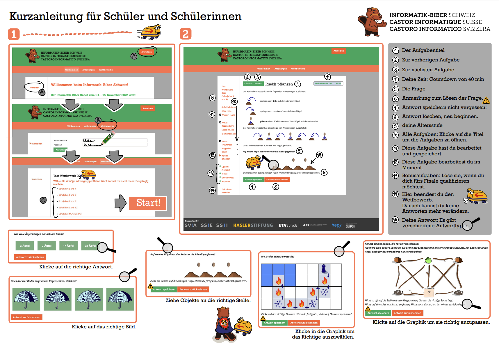

import DefinitionList from "@tdev-components/DefinitionList";
import CmsText from '@tdev-components/documents/CmsText';
import WithCmsText from '@tdev-components/documents/CmsText/WithCmsText';

# Informatik-Biber 2026 🦫

Datum 📅
: Einzellektion in der Woche vom 9. - 20. November
: (gemäss Terminplan)
Zeitrahmen ⏱️
: 5 Minuten Vorbereitungszeit
: 40 Minuten Zeit für den Wettbewerb
Bewertung ✔
: wird **nicht** mit einer Note bewertet
Ziel 🎯
: sich herausfordern
: sich mit spannenden, besonderen Informatik-Fragen auseinandersetzen

:::info[Login]
<WithCmsText 
    entries={{
        username: "72df29ab-7c62-4691-aebe-3b69bf62eb67",
        password: "455e9bd2-363d-4a43-91d1-a3e2fee65dca", 
    }}
>
    <DefinitionList>
        <dt>Benutzername</dt>
        <dd><CmsText name="username" /></dd>
        <dt>Passwort</dt>
        <dd><CmsText name="password" /></dd>
    </DefinitionList>
</WithCmsText>
:::

1. https://wettbewerb.informatik-biber.ch öffnen
2. Mit den obigen Zugangsdaten einloggen
3. Altersgruppe auswählen (es sollte nur eine Option geben)
4. Auf __Start__ klicken (**keine:n Team-Partner:in anmelden**)
5. Nochmal auf __Start__ klicken
6. So viele Fragen wie möglich bearbeiten (siehe [Kurzanleitung](#kurzanleitung) unten)

Viel Spass und viel Erfolg! 🍀🥳

## Kurzanleitung

