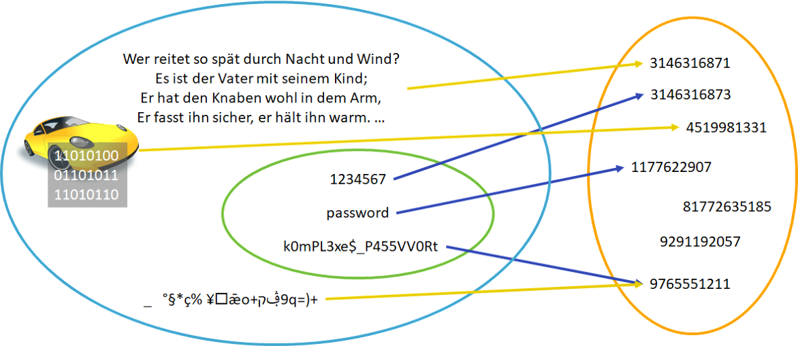

import HashSHA2 from '@tdev-components/VisualizationTools/cryptology/HashSHA2'

# Hashing

:::insight[Ausgangsfrage]
Wie kann man die **Identität** eines Dokuments eindeutig feststellen, ohne dass der gesamte Inhalt des Dokuments verglichen werden muss?
:::

Bei Menschen gibt es gängige Methoden, um die Identität einer Person zu bestimmen, ohne gleich die gesamte DNA zu vergleichen.

:::cards{columns=3}

::br

::br

:::

Es reicht aus, ein Ausprägungsmerkmal zu vergleichen, um die Identität einer Person festzustellen. Bei Dokumenten kann man ähnlich vorgehen: Man kann den Inhalt eines Dokuments mit einer **Hashfunktion** auf einen **Hashwert** abbilden. Der Hashwert ist wie ein Fingerabdruck für das Dokument. 

## Verfahren

Durch ein Verfahren soll der Inhalt eines Dokuments auf eine einzelne Zahl (oder einen kurzen Text) abgebildet werden. Einige solche Verfahren kennen Sie bereits:

:::aufgabe[Verfahren finden]{.slim-table}
<TaskState id="3fb0fd5e-deec-4777-a9b3-3492e7db27c8" />

Bestimmen Sie jeweils die Quersumme bzw. die alternierende Quersumme der folgenden Zahlen:

| Zahl       | Iterierte Quersumme                                                             | Alternierende Quersumme                                                          |
|:-----------|:--------------------------------------------------------------------------------|:---------------------------------------------------------------------------------|
| 12345      | 6                                                                               | 3                                                                                |
| 123456     | <Answer type="string" solution="3" id="e69d1ce5-8b8f-498b-b7a0-6a9285ded4f3" /> | <Answer type="string" solution="-3" id="b0968b82-f8ec-4ced-b9db-12120cd364c7" /> |
| 12345678   | <Answer type="string" solution="9" id="d1121725-efd0-4932-86f5-aa3be29524e4" /> | <Answer type="string" solution="-4" id="f682386e-811c-4e75-b5f0-6a6ea3b4182b" /> |
| 123456789  | <Answer type="string" solution="9" id="912e133d-2880-4a21-945a-ec9a36b8b687" /> | <Answer type="string" solution="5" id="c9ab782b-c5d6-4b8e-9a92-6d07532c83a8" />  |
| 11111111   | <Answer type="string" solution="8" id="fda65a38-dc5b-4b09-9471-96aa45d2d5fb" /> | <Answer type="string" solution="0" id="7a7586c9-a3c8-472e-bbec-01a74bd7e314" />  |

Sind die beiden Verfahren geeignet, um die Identität von Zahlen eindeutig festzustellen? Begründen Sie Ihre Antwort.

<Answer type="text" id="2369be26-ea13-4145-b865-08a06e36694a" />

<Solution id="aae9bb69-e465-436a-ad24-858c27c09510">

Nein, beide Verfahren taugen nicht, um die Identität von Zahlen eindeutig festzustellen. Bei der iterierten Quersumme ist es offensichtlich, bei der alternierenden Quersumme gibt es ebenfalls leicht zu findende Gegenbeispiele:

Berechnen Sie die alternierende Quersumme und bemerken Sie die Kollisionen mit den obigen Zahlen:

| Zahl       | Alternierende Quersumme                                                          |
|:-----------|:---------------------------------------------------------------------------------|
| 123123     | <Answer type="string" solution="0" id="1870de82-8bef-416e-9170-0f97b3da5a2d" />  |
| 1234567809 | <Answer type="string" solution="5" id="5a230cdc-2e26-4d67-b72c-f7ee3004c22b" />  |
</Solution>
:::

Dennoch wäre es praktisch, wir könnten Zahlen oder Dokumente durch eine einfache Rechnung von einer langen Zahl auf eine kurze Zahl abbilden, ohne dass dabei doppelte Ergebnisse für unterschiedliche Zahlen entstehen.

## Hashfunktionen

:::definition[Hashfunktion]
Eine Hashfunktion ist eine Abbildung, die eine grosse Eingabemenge auf eine kleinere Zielmenge abbildet.
:::

In der Abbildung oben wird visualisiert, dass wir zwar doppelte Ergebnisse, sogenannte **Kollisionen**, verhindern möchten, aber theoretisch nicht verhindern können, da die Eingabemenge (z.B. alle möglichen Dokumente) grösser ist als die Zielmenge (z.B. alle möglichen Hashwerte).

:::definition[Kollisionsresistenz]
Um genügend Sicherheit zu bieten, soll eine gute kryptographische Hashfunktion folglich **kollisionsresistent** sein. Das heisst, es soll praktisch unmöglich sein, Kollisionen zu finden.
:::

## Aktuelle Beispiele
Es gibt verschiedene aktuelle Hashfunktionen. Nachfolgend ein Tool, welches SHA-2 Hashes (Secure Hash Algorithm Version 2) berechnet.

<HashSHA2 />

:::aufgabe[Hashes berechnen]
<TaskState id="c4582e86-a05f-4c62-bcdc-4e262b37165a" />
1. Berechnen Sie den Hash Ihres Namens und den Ihrer E-Mail-Adresse. Halten Sie beide Hash-Werte fest.
2. Wie viele Buchstaben ändern sich, wenn Sie einen einzigen Tippfehler machen?

<QuillV2 id="0eef49c1-5d5e-49fb-910d-fe456ff75da4" />

<Solution id="81633946-8e93-447b-9e08-962d68b4a7fc">
1. Individuelle Lösung.
2. Vermutlich ändert sich ein Grossteil der Buchstaben, wenn nicht sogar fast alle. Das ist das Ziel einer sicheren (kryptographischen) Hashfunktion (siehe unten).
</Solution>
:::

:::aufgabe[Veränderungen erkennen]
<Answer type="state" id="370b5dbd-fed3-4908-af0e-cd89028bc683" />
Hat sich der Inhalt der Wikipedia-Seite [Hash Funktionen](https://en.wikipedia.org/wiki/Hash_function) seit dem letzten Zugriff am 10.10.2026 verändert? Prüfen Sie dies, indem Sie auf die Seite gehen, mit [[Ctrl]]+[[A]] den gesamten Inhalt markieren und den Hashwert berechnen.

10.10.2026
: Hashwert: `9963534c07231eb4f420fcac10d9d9c02a8c55e8acfb72c902aee3c13be39110`
Heute
: <Answer label="Datum" type="string" id="97ad1d89-e38b-41ad-8d3d-83a94967377a" inline />
: <Answer label="Hashwert" type="string"  id="d5e2c32a-1873-464d-916b-cc58baefaea5" inline />

Ist der Inhalt noch derselbe? Falls nicht: sehen Sie dem Hashwert an, was oder wie stark sich der Inhalt verändert hat?

<Answer type="text" id="f93f61b2-a511-4228-a0e1-8801af69f07f" />
:::

:::insight[Kleine Änderung, Grosse Auswirkung]
Die letzten beiden Beispiele zeigen, dass bereits kleinste Änderungen zu komplett anderen Hashwerten führen. Kryptographische Hashfunktion sind so konstruiert, dass bei einer Änderung an einem Bit min. 50% der Hashwert-Bits ändern.

Damit erreichen wir unter anderem, dass wir aus einer Ähnlichkeit zweier Hashwerten **nicht** auf eine Ähnlichkeit der beiden entsprechenden Eingabewerte schliessen können. So ist es nahezu unmöglich, den Eingabewert durch «Annäherung» herauszufinden.
:::

::::aufgabe[Hashwerte und Sicherheit]
<Answer type="state" id="845e9189-6100-4b92-bce1-ab7563d2e58b" />

1. Weshalb stellt der Entwickler von [PyCraft](https://simplay.github.io/pycraft/) (einer Python-Version von Minecraft) auf seiner Webseite den Hashwert der Installationsdatei zur Verfügung?
2. Was könnte dies mit Virenschutz zu tun haben?

<Answer type="text" id="2d3104c7-6afb-48db-9449-3703ce7fb08d" />

<Solution id="fbcff5dc-c739-493e-bc54-853c3bbea28a">
1. Ein Hashwert ist eine Art digitaler Fingerabdruck der Installationsdatei. Nach dem Download kann man den Hashwert der heruntergeladenen Datei berechnen und mit dem veröffentlichten Wert vergleichen. Stimmen beide überein, spricht das dafür, dass die Datei unverändert heruntergeladen wurde. Ein abweichender Wert deutet auf eine beschädigte oder veränderte Datei hin.
2. Würde jemand die Installationsdatei manipulieren und beispielsweise Schadsoftware einbauen, würde sich ihr Hashwert normalerweise ändern. Der Vergleich kann solche Manipulationen erkennen.

:::warning[Hashwert ≠ Virenschutz]
Ein passender Hashwert beweist jedoch nicht, dass die Datei virenfrei ist: Der Entwickler könnte Schadsoftware in die Datei einbauen. Ausserdem muss der veröffentlichte Vergleichswert vertrauenswürdig sein. Könnte ein Angreifer Datei und Hashwert austauschen, wäre der Vergleich wirkungslos.
:::
</Solution>
::::

