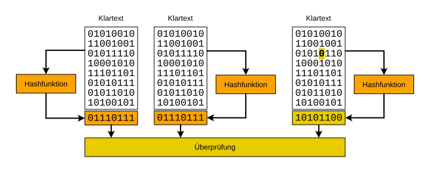

---
sidebar_custom_props:
  source:
    name: rothe.io
    ref: 'https://rothe.io/?b=crypto&p=559733'
page_id: a234dbad-32da-47ed-9af3-e1c9fc95c9a4
---

# Verfahren kombinieren

:::insight[Ausgangslage]
Für uns ist Wichtig:
- Die Dokumente sind stets lesbar und trotzdem vor Manipulationen geschützt.
- Asymmetrische Verfahren sollen eingesetzt werden, aber nicht zum Verschlüsseln des ganzen Dokuments, weil dies langsam ist.
:::

## Manipulationen erkennen
Ist der Klartext stets sichtbar, muss sichergestellt werden, dass er nicht manipuliert werden kann. Schliesslich will man nicht, dass ein Vertrag nach dem Signieren noch unentdeckt verändert werden kann.

:::flex{min-width=150px}
Wir haben gesehen, dass Hashwerte eine Art digitale **Fingerabdrücke** sind. Es ist extrem schwierig (resp. in vernünftiger Zeit nicht möglich), zu einem bestehenden Text einen anderen zu finden, der denselben Hashwert erzeugt.

::br{align-self=center}

:::

Auch wenn verschiedene Personen den Hashwert desselben Textes berechnen, ergibt sich stets derselbe Hashwert (sofern dieselbe Hashfunktion verwendet wird). Ist ein Text auch nur ein wenig anders, so ergibt sich sofort ein völlig anderer Hashwert, womit leicht zu erkennen ist, dass die Texte **nicht** übereinstimmen.

Da die Hashwerte im Vergleich zum eingegebenen Text sehr kurz sind (wie der Fingerabdruck eines Menschen sehr klein ist im Vergleich zu all dem, was den Menschen mit diesem Fingerabdruck ausmacht), können wir den Hashwert eines Textes **signieren** (also mit dem privaten Schlüssel verschlüsseln) und so die **Authentizität** des Textes sicherstellen.

> Anstelle des gesamten Textes signieren wir nur den Hashwert, was die beiden obengenannten Punkte der Ausgangslage erfüllt.

:::aufgabe[Digitale Signaturen überprüfen]
<Answer type="state" id="cd131599-9400-4ba6-9ef2-688b4b1ea20a" />

Im obigen Bild ist das digitale Signatur-Verfahren dargestellt. Ein wesentlicher Schritt fehlt aber noch: die Überprüfung der digitalen Signatur. Was muss die Empfänger:in noch tun, um die digitale Signatur zu überprüfen? 

Erklähren Sie den Vorgang bspw. mit Alice und Bob - wann wird welcher Schlüssel verwendet und was wird wie überprüft?

<Answer type="text" id="99cd9f5a-6715-44a8-89cf-c79770c0740b" />

<Solution id="5bacd9c8-2222-47c2-bc1d-e90116caf1d0">

</Solution>
:::

