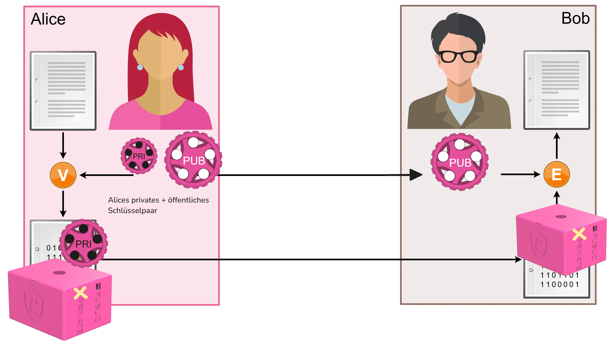
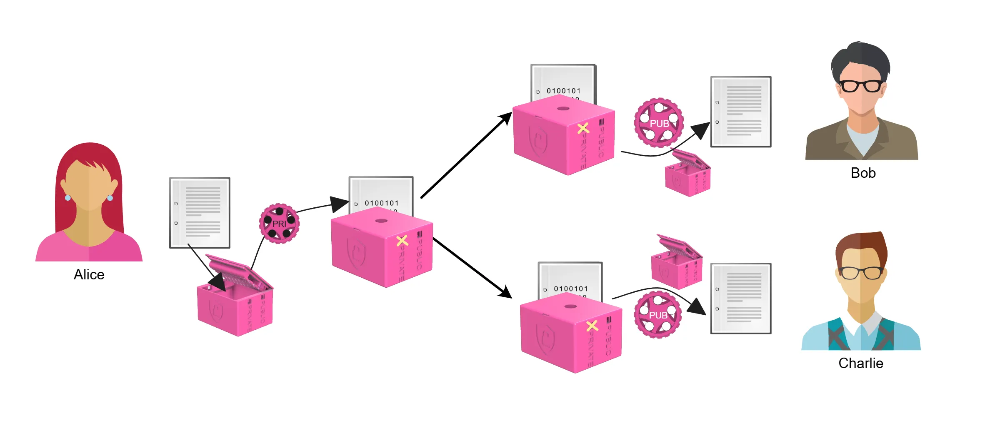
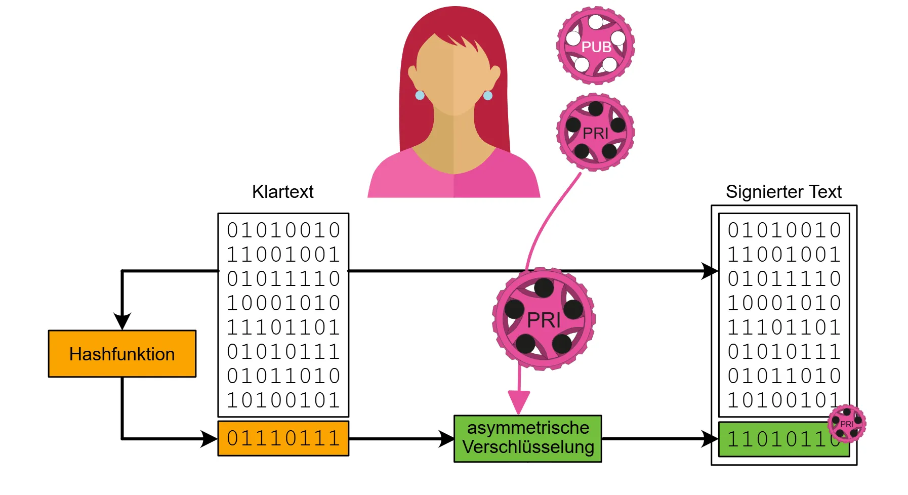
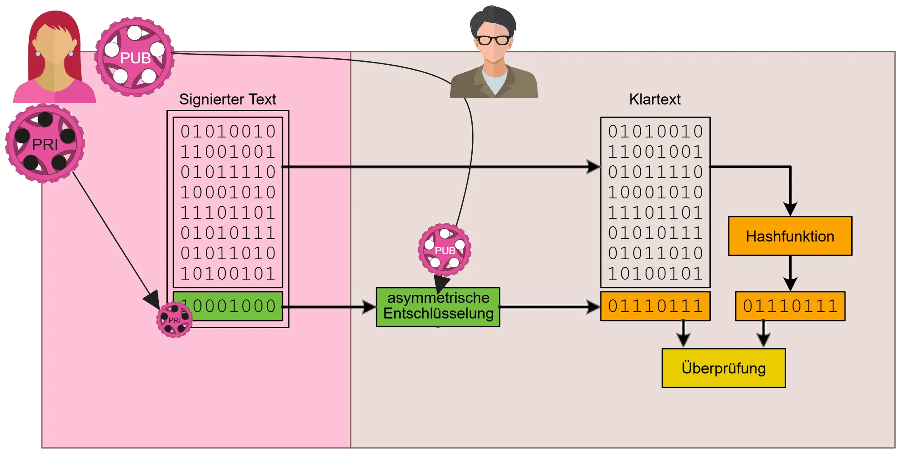

# Digitale Signatur

Das Prinzip der digitalen Signatur ist einfach: Die Absender:in verschlüsselt eine Nachricht mit ihrem privaten Schlüssel und *beweist* dadurch, dass sie die Nachricht tatsächlich verfasst hat. Empfänger:innen können diese Nachricht dann mit dem öffentlichen Schlüssel der Absender:in entschlüsseln und somit **verifizieren**, dass die Nachricht tatsächlich von der Absender:in stammt.

:::tip[Digitale Signatur]
Wenn Bob die Nachricht mit dem öffentlichen Schlüssel von Alice entschlüsseln kann, dann muss diese Nachricht vorher mit dem privaten Schlüssel von Alice verschlüsselt worden sein. Somit kann sie von niemand anderem stammen als von Alice selbst. D.h. diese Nachricht ist quasi digital signiert.
:::

:::aufgabe[Aufgabe mehrere Leute]
<Answer type="state" id="9a23f76b-2500-459d-8ffc-dc4da5d06a6a" />

Überlegen Sie sich, wie ein signiertes Dokument von mehr als einer Person angeschaut und überprüft wird. Welche Schlüssel werden verwendet?

<Answer type="text" id="6e6c19e8-7a15-41cc-83b4-ca2987de22d1" />

<Solution id="7ff60a15-ccaa-4ab4-98f5-a908c6b89c6e">

</Solution>
:::

## Nachteile

:::danger[Nachteile der bisherigen digitalen Signatur]
Die oben beschrieben Art der digitalen Signatur ist **nicht optimal**, denn es gibt mehrere Probleme:
Klartext unlesbar
: Wegen der «Signatur» ist der Klartext nicht mehr lesbar.
: Dies ist umständlich, denn wenn Sie ein Dokument auf Papier unterschreiben, bleibt dieses trotzdem lesbar.
Geschwindigkeit
: Asymmetrische Verfahren sind langsam, d.h. wenn ein grosses Dokument (z.B. ein Video) signiert wird, dauert dieser Vorgang unnötig lange, genauso wie das Überprüfen der Signatur (also das Entschlüsseln).
:::

:::aufgabe[Verfahren kombinieren]
<Answer type="state" id="414ffed2-cdf4-4bba-b213-a9046531942a" />

Wie könnten **Hashwerte** helfen, dieses Problem zu lösen?

<Answer type="text" id="6f19dfc8-a150-4cd1-a95f-e082d664e5f1" />
<Solution id="67f77b3f-b10e-46c2-b690-dc3a01a6ea00">
Zuerst wird mit einer Hashfunktion ein Hashwert des Klartextes berechnet - das ist effizient und schnell. Anschliessend wird dieser Hashwert mit dem privaten Schlüssel verschlüsselt, um die digitale Signatur zu erzeugen. Die Empfänger:in kann dann den Hashwert mit dem öffentlichen Schlüssel entschlüsseln und mit dem selbst berechneten Hashwert des Klartextes vergleichen. Stimmen die beiden Hashwerte überein, ist die Signatur gültig und der Klartext wurde nicht manipuliert.
</Solution>
:::

## Manipulationen erkennen
Ist der Klartext stets sichtbar, muss sichergestellt werden, dass er nicht manipuliert werden kann. Schliesslich will man nicht, dass ein Vertrag nach dem Signieren noch unentdeckt verändert werden kann.

:::flex{min-width=150px}
Wir haben gesehen, dass Hashwerte eine Art digitale **Fingerabdrücke** sind. Es ist extrem schwierig (resp. in vernünftiger Zeit nicht möglich), zu einem bestehenden Text einen anderen zu finden, der denselben Hashwert erzeugt.

::br{align-self=center}

:::

Auch wenn verschiedene Personen den Hashwert desselben Textes berechnen, ergibt sich stets derselbe Hashwert (sofern dieselbe Hashfunktion verwendet wird). Ist ein Text auch nur ein wenig anders, so ergibt sich sofort ein völlig anderer Hashwert, womit leicht zu erkennen ist, dass die Texte **nicht** übereinstimmen.

Da die Hashwerte im Vergleich zum eingegebenen Text sehr kurz sind, kann der Hashwert eines Textes **signiert** werden (also mit dem privaten Schlüssel verschlüsseln) und so die **Authentizität und Integrität** des Textes sicherstellen.

:::insight
Anstelle des gesamten Textes wird nur der Hashwert signiert.
Klartext
: bleibt durchgehgehend lesbar
Geschwindigkeit
: ist schnell, da nur der Hashwert signiert wird
:::

:::aufgabe[Digitale Signaturen überprüfen]
<Answer type="state" id="cd131599-9400-4ba6-9ef2-688b4b1ea20a" />

Im obigen Bild ist das digitale Signatur-Verfahren dargestellt. Ein wesentlicher Schritt fehlt aber noch: die Überprüfung der digitalen Signatur. Was muss die Empfänger:in noch tun, um die digitale Signatur zu überprüfen? 

Erklähren Sie den Vorgang bspw. mit Alice und Bob - wann wird welcher Schlüssel verwendet und was wird wie überprüft?

<Answer type="text" id="99cd9f5a-6715-44a8-89cf-c79770c0740b" />

<Solution id="5bacd9c8-2222-47c2-bc1d-e90116caf1d0">

</Solution>
:::

## Signaturen und Zertifikate

Täglich verwenden Sie digitale Signaturen und vertrauen darauf, dass diese korrekt sind. Bei jedem Besuch einer Webseite mit HTTPS wird eine digitale Signatur überprüft, um sicherzustellen, dass die Webseite tatsächlich von der Organisation stammt, die sie vorgibt zu sein. Dies geschieht über **Zertifikate**, die von vertrauenswürdigen **Zertifizierungsstellen** (Certificate Authorities, CAs) ausgestellt werden. Dies verhindert schlussendlich auch [MITM-Angriffe](https://de.wikipedia.org/wiki/Man-in-the-Middle-Angriff).

:::tip[Ausgangslage]
Die Funktionsweise basiert auf den bisherigen Erkenntnissen und löst das Problem, wie Empfänger:innen den öffentlichen Schlüssel der Absender:in sicher erhalten können.
:::

**Zertifizierungsstellen** stellen digitale Zertifikate aus. Diese bestätigen, dass ein öffentlicher Schlüssel zu einer bestimmten Identität gehört, beispielsweise zu einer Website. Die Zertifizierungsstelle signiert das Zertifikat mit ihrem privaten Schlüssel. Wer ihrem öffentlichen Schlüssel vertraut, kann damit die Signatur des Zertifikats überprüfen und anschliessend den darin bestätigten öffentlichen Schlüssel zur Überprüfung signierter Daten verwenden.

Die Empfänger:in muss dabei nur einer begrenzten Anzahl von Root-Zertifizierungsstellen unmittelbar vertrauen. Diese können auch weiteren Zertifizierungsstellen Zertifikate ausstellen und sie damit zum Ausstellen eigener Zertifikate berechtigen. So entsteht eine Vertrauenskette, eine sogenannte Chain of Trust, die bis zu einer bereits vertrauenswürdigen Root-Zertifizierungsstelle zurückführt.

Root-Zertifikate enthalten die öffentlichen Schlüssel vertrauenswürdiger Root-Zertifizierungsstellen und sind in den meisten Betriebssystemen und Browsern bereits vorinstalliert. Mithilfe dieser Zertifikate und einer gültigen Vertrauenskette kann überprüft werden, ob ein erhaltener öffentlicher Schlüssel tatsächlich zur angegebenen Absender:in gehört. Mit diesem Schlüssel lässt sich anschliessend die digitale Signatur der empfangenen Daten überprüfen.

:::aufgabe[Wer stellt Zertifikate aus?]
<Answer type="state" id="96de5915-6913-4534-8973-ab621a790373" />

Tool
: https://tools.trustico.com/chain

Verwenden Sie das obige Tool und überprüfen Sie für Ihre Lieblingswebseite, welche Zertifizierungsstelle das Zertifikat ausgestellt hat, wie viele Zwischenzertifizierungsstellen es gibt und welche Root-Zertifizierungsstelle das Zertifikat signiert hat.

<Answer type="text" id="f45118f7-81fc-4b86-b614-de3fec34aa7e" />
:::