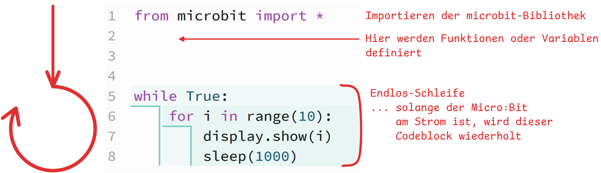

import Strukto from '@tdev-components/VisualizationTools/Strukto';
import ChoiceAnswer from '@tdev-components/documents/Assessable/ChoiceAnswer';
import Hint from '@tdev-components/documents/Assessable/Feedback/Hint';
import Quiz from '@tdev-components/documents/Assessable/Quiz';
import TrueFalseAnswer from '@tdev-components/documents/Assessable/TrueFalseAnswer';
import { multipleChoicePoints, points } from '@tdev-components/documents/Assessable/helpers/scoring';

# 1. Intro

## Algorithmus

> «Ein Algorithmus beschreibt die Methode, mit der eine Aufgabe gelöst wird. Ein Algorithmus besteht aus einer Folge von Schritten, deren korrekte Abarbeitung die gestellte Aufgabe löst. Die Abarbeitung oder den Vorgang selbst bezeichnet man als Prozeß.»
> 
> Les Goldschlager/Andrew Lister: *Informatik*, 1984


Damit wir von einem Algorithmus sprechen, müssen also **zwei** Bedingungen erfüllt sein:
1. Es muss eine **Schritt-für-Schritt-Anleitung** vorliegen.
2. Diese Schritt-für-Schritt-Anleitung muss eine **Aufgabe oder ein Problem lösen**.

## Struktur
Ein Algorithmus definiert, in welcher **Reihenfolge** die einzelnen Schritte nacheinander abgearbeitet werden. Die Beschreibung dieser Reihenfolge ist die **Struktur** des Algorithmus. Während die Einzelschritte je nach Anwendungsgebiet unterschiedlich sind, sind die Strukturen (beim Programmieren spricht man von **Kontrollstrukturen**) von Algorithmen universell.

Folgende Strukturen können unterschieden werden:
Sequenz 👣
: eine Folge von Schritten/Anweisungen, die nacheinander abgearbeitet werden.
:::dd
```py live_py slim
from turtle import *

forward(100)
left(120)
forward(100)
left(120)
forward(100)
left(120)
```
:::
Wiederholung 🔁
: Einer oder mehrere Schritte werden eine bestimmte Anzahl mal wiederholt.
:::dd
```py live_py slim
from turtle import *

for i in range(3):
    forward(100)
    left(120)
```
:::
Bedingte Ausführung ⑂
: Einer oder mehrere Schritte werden nur ausgeführt, wenn eine bestimmte Bedingung erfüllt ist.
:::dd
```py live_py slim
from random import randint

zahl1 = randint(1, 10)
zahl2 = randint(1, 10)
antwort = input(f'{zahl1} * {zahl2} = ? ')
antwort = int(antwort)
lösung = zahl1 * zahl2
if antwort == lösung:
    print(f'😎 Richtig! {zahl1} * {zahl2} = {lösung}')
else:
    print(f'🥸 {antwort} ist Falsch! {zahl1} * {zahl2} = {lösung}')
```
:::
Unterprogramm 🏷
: Eine Sequenz kann mit einem Namen versehen werden. Anstatt immer die ganze Sequenz aufzuschreiben, kann der Name angegeben werden.
:::dd
```py live_py slim
from turtle import *
def dreieck():
    for i in range(3):
        forward(100)
        left(120)
dreieck()
left(90)
dreieck()
```
:::
Parameter ⊕ ⊖
: Das Ergebnis eines Algorithmus kann variiert werden durch Werte, welche bei jeder Ausführung neu festgelegt werden.
:::dd
```py live_py slim
from turtle import *
def dreieck(seitenlänge, farbe):
    color(farbe)
    for i in range(3):
        forward(seitenlänge)
        left(120)
dreieck(100, 'blue')
dreieck(50, 'red')
```
:::

## Schleifen

Mit **Schleifen** können Anweisungen wiederholt ausgeführt werden, ohne dass diese mehrfach aufgeschrieben werden müssen. Es gibt zwei Arten von Schleifen:
- **Zählschleifen**: Die Anzahl der Wiederholungen ist im Voraus bekannt.
- **Bedingte Schleifen**: Die Anzahl der Wiederholungen ist nicht im Voraus bekannt, sondern hängt von einer Bedingung ab.

Bisher haben wir nur Zählschleifen - die `for`-Schleife - kennengelernt.

### Die `for`-Schleife
```py live_py slim
from turtle import *

for i in range(5):
    forward(100)
    left(72)
```

Das `i` in der Schleife ist der **Schleifenzähler** und gibt an, wie oft die Schleife bereits durchlaufen wurde. Er wird also bei jeder Wiederholung um 1 erhöht und beginnt bei `0`. **Der Schleifenzähler kann innerhalb der Schleife verwendet werden.**

```py live_py slim
from turtle import *

for i in range(5):
    forward(10 * i)  # Die Länge der Linie hängt vom Schleifenzähler ab
    left(90)
```

<ChoiceAnswer correct={[1]} randomizeOptions id="3ea91c6c-697f-4aa2-a182-2af7adba4412">
    > Welche Längen haben die einzelnen Linien, die gezeichnet werden?
    - 0, 10, 20, 30, 40
    - 10, 20, 30, 40, 50
    <Hint when="assessed" not={['not_answered']} noWrap>
        :::tip[Beachte]
        Es gibt **nur 4** gezeichnete Linien, da der Schleifenzähler bei `0` beginnt und bis `4` geht (was auf **Z. 4** Seitenlängen von `0`, `10`, `20`, `30`, `40` erzeugt).
        :::
    </Hint>
</ChoiceAnswer>


:::def[`for i in range(start, stopp):`]
Die `for`-Schleife kann auch mit zwei Parametern verwendet werden: `start` und `stopp`. Der Schleifenzähler beginnt dann bei `start` und läuft bis `stopp - 1`.

```py live_py slim
from turtle import *

for i in range(1, 6):  # Schleifenzähler läuft von 1 bis 5
    forward(10 * i)
    left(90)
```
:::

:::insight[Merke]
Bei der `for`-Schleife muss bereits im **Voraus** bekannt sein, wie oft die Schleife durchlaufen werden soll.
:::

### Die `while`-Schleife
Die `while`-Schleife ist eine **bedingte Schleife**, ein Code-Block wird so lange wiederholt, wie eine bestimmte Bedingung erfüllt ist. Zähl-Schleifen können immer auch mit einer `while`-Schleife realisiert werden - der Schleifenzähler wird dabei in einer selbst definierten Variable gespeichert.

:::flex{flexBasis=300px}
    **`for`-Schleife**

    ```py live_py slim minLines=7
    from turtle import *


    for i in range(4):
        forward(100)
        left(90)
    ```
::br
    **`while`-Schleife**

    ```py live_py slim
    from turtle import *

    i = 0
    while i < 4:
        forward(100)
        left(90)
        i = i + 1
    ```
:::
:::::tip[Beachte]
<div className="compactDeflist">
    Z. 3
    : Der Schleifenzähler `i` wird initialisiert (auf `0` gesetzt).
    Z. 4
    : Die Bedingung der Schleife. Solange `i` kleiner als `4` ist, wird die Schleife ausgeführt.
    Z. 8
    : Der Schleifenzähler wird um `1` erhöht.
    ::::dd
        :::warning[Achtung: :mdi[all-inclusive]-Schleifen!]
        Wenn die Bedingung der `while`-Schleife **niemals** falsch wird, läuft die Schleife unendlich weiter. Dann muss der Tab geschlossen und erneut geöffnet werden!
        :::
    ::::
</div>
:::::


::::aufgabe[Aufgabe 1: `for` zu `while`]
<Answer type="state" id="a3946a2c-10d3-400f-86e8-4c6546e72fe6" />

Schreiben Sie das untenstehende Programm so um, dass nur noch `while` Schleifen verwendet werden.

:::flex{flexBasis="200px"}
```py live_py slim
from turtle import *

left(60)

for i in range(5):
    forward(100)
    left(72)
    backward(20) 
```

::br

```py live_py title=to-while.py id=7b2fe0cc-0a85-438d-ad2a-5a507b3055a5
from turtle import *
```
:::

<Solution id="3a41511e-0119-4560-a9c8-9c2d70ae8dbb">
  ```py live_py slim
  from turtle import *

  left(60)
  i = 0
  while i < 5:
      forward(100)
      left(72)
      backward(20)
      i = i + 1
  ```
</Solution>
::::


Die eigentliche Stärke der `while`-Schleife liegt aber darin, dass die Anzahl Wiederholungen **im Voraus nicht bekannt** sein muss. Die Schleife läuft so lange, bis eine bestimmte Bedingung erfüllt ist.

Obiges Kopfrechen-Beispiel könnte mit einer `while`-Schleife zu einem Kopfrechentraining erweitert werden, der so lange neue Aufgaben stellt, bis `x` eingegeben wird:

```py live_pyo slim
from random import randint
antwort = ''
while antwort != 'x':
    zahl1 = randint(1, 10)
    zahl2 = randint(1, 10)
    antwort = input(f'{zahl1} * {zahl2} = ? (x zum Beenden) ')
    if antwort != 'x':
        antwort = int(antwort)
        lösung = zahl1 * zahl2
        if antwort == lösung:
            print(f'😎 Richtig! {zahl1} * {zahl2} = {lösung}')
        else:
            print(f'🥸 {antwort} ist Falsch! {zahl1} * {zahl2} = {lösung}')
```

## Anwendung

Die `while`-Schleife kommt oft bei Benutzerinteraktionen, Simulationen oder bei sich dynamisch ändernden Daten vor. Sonstige Wiederholungen lassen sich normalerweise verständlicher mit einer `for`-Schleife umsetzen.

:::insight{.smallDeflist}
`while`-Schleife
: Die `while`-Schleife wird immer dann verwendet, wenn die Anzahl Wiederholungen **im Voraus unbekannt** ist.
`for`-Schleife
: Ist die Anzahl Wiederholungen **im Voraus bekannt**, wird meistens die `for`-Schleife verwendet.
:::

Dies ist etwa der Fall bei Micro:Bit-Programmen - sie sollen im Normalfall sogar **unendlich** lange laufen, bis der Micro:Bit ausgeschaltet wird. Die Programme enthalten also eine `while`-Schleife, die immer wahr ist:



Dies ist die sogenannte **Hauptschleife**. Alle Anweisungen innerhalb dieser Schleife werden immer wieder ausgeführt, bis der Micro:Bit ausgeschaltet wird.

Dieselbe Ausgangslage gibt es auch, wenn bspw. eine digitale Stoppuhr programmiert wird - sie soll so lange laufen, bis die Benutzer:in das Programm beendet.

```py live_pyo slim
from time import sleep
from os import system

sekunden = 0

while True:
    system('clear')  # Bildschirm löschen
    print(f'{sekunden} Sekunden')
    sekunden = sekunden + 1
    sleep(1)  # 1 Sekunde warten
```

## Quiz

<Quiz id="3a16da9f-bed4-448a-96f0-8076f3667fb4" scoring={points(1)} resetMode="incorrect">

<ChoiceAnswer multiple correct={[2, 4]} scoring={multipleChoicePoints(2, 1, false)}>
Welche Bedingungen muss ein Algorithmus erfüllen? Wählen Sie alle korrekten Aussagen.

1. Er muss in Python geschrieben sein.
2. Er muss eine Schritt-für-Schritt-Anleitung enthalten.
3. Er muss eine Schleife enthalten.
4. Seine korrekte Abarbeitung muss eine Aufgabe oder ein Problem lösen.

<Hint when="assessed">
Ein Algorithmus beschreibt Schritte zur Lösung einer Aufgabe. Er kann auch ohne Programmiersprache
und ohne Wiederholung beschrieben werden.
</Hint>
</ChoiceAnswer>

<ChoiceAnswer correct={[3]}>
Eine Turtle soll zuerst 100 Schritte vorwärtsgehen und danach um 90 Grad nach links drehen.
Welche Struktur beschreibt diese beiden nacheinander ausgeführten Anweisungen?

1. Bedingte Ausführung
2. Wiederholung
3. Sequenz
4. Parameter

<Hint when="assessed">
Eine Sequenz ist eine Folge von Anweisungen, die nacheinander abgearbeitet werden.
</Hint>
</ChoiceAnswer>

<ChoiceAnswer multiple correct={[1, 3]} scoring={multipleChoicePoints(2, 1, false)}>
Betrachten Sie das Unterprogramm. Wählen Sie alle korrekten Aussagen.

```py showLineNumbers
def dreieck(seitenlänge, farbe):
    color(farbe)
    for i in range(3):
        forward(seitenlänge)
        left(120)

dreieck(100, 'blue')
dreieck(50, 'red')
```

1. Mit dem Namen `dreieck` kann dieselbe Anweisungsfolge mehrfach aufgerufen werden.
2. Beide Aufrufe zeichnen ein Dreieck mit derselben Seitenlänge.
3. Die Parameter legen bei jedem Aufruf die Seitenlänge und die Farbe fest.
4. Auch ohne die Zeilen 7 und 8 wird von der Definition mit `def` ein Dreieck gezeichnet.

<Hint when="assessed">
`def` definiert das Unterprogramm. Erst ein Aufruf führt es aus. Die beiden Aufrufe verwenden
unterschiedliche Werte für Seitenlänge und Farbe: 100 und Blau sowie 50 und Rot.
</Hint>
</ChoiceAnswer>

<ChoiceAnswer correct={[4]}>
Welche Zahlen gibt dieses Programm nacheinander aus?

```py
for i in range(2, 5):
    print(10 * i)
```

1. `0, 10, 20, 30, 40`
2. `20, 30, 40, 50`
3. `10, 20, 30, 40`
4. `20, 30, 40`

<Hint when="assessed">
`range(2, 5)` liefert die Werte 2, 3 und 4. Der Stoppwert 5 gehört nicht dazu.
Diese drei Werte werden jeweils mit 10 multipliziert.
</Hint>
</ChoiceAnswer>

<ChoiceAnswer correct={[2]}>
Welche Zahlen gibt dieses Programm nacheinander aus?

```py
i = 1
while i < 4:
    print(i)
    i = i + 1
```

1. `0, 1, 2, 3`
2. `1, 2, 3`
3. `1, 2, 3, 4`
4. Nur `1`

<Hint when="assessed">
Die Schleife beginnt mit `i = 1`. Nach jeder Ausgabe wird `i` erhöht.
Sobald `i` den Wert 4 erreicht, ist `i < 4` falsch und die Schleife endet.
</Hint>
</ChoiceAnswer>

<TrueFalseAnswer correct={false}>
Der eingerückte Code-Block einer `while`-Schleife wird immer mindestens einmal ausgeführt,
auch wenn die Bedingung bereits vor dem ersten Durchlauf falsch ist.

<Hint when="assessed">
Die Bedingung wird vor jedem Durchlauf geprüft, auch vor dem ersten.
Ist sie bereits zu Beginn falsch, wird der Code-Block kein einziges Mal ausgeführt.
</Hint>
</TrueFalseAnswer>

<ChoiceAnswer correct={[1]}>
Dieses Programm soll viermal `Hallo` ausgeben. Welche Anweisung muss anstelle des Kommentars
eingerückt in die Schleife eingefügt werden, damit sie danach endet?

```py
i = 0
while i < 4:
    print('Hallo')
    # Hier eine Anweisung ergänzen
```

1. `i = i + 1`
2. `i = 0`
3. `i = i - 1`
4. `print(i)`

<Hint when="assessed">
`i = i + 1` erhöht den Zähler nach jeder Ausgabe. Nach vier Durchläufen ist `i = 4`
und die Bedingung falsch. Bei den anderen Anweisungen bleibt `i < 4` immer wahr.
</Hint>
</ChoiceAnswer>

<ChoiceAnswer correct={[3]}>
Im Kopfrechentraining wird zuerst `antwort = ''` gesetzt. Danach werden Aufgaben gestellt,
solange `antwort != 'x'` gilt. Warum passt hier eine `while`-Schleife?

1. Eine `while`-Schleife führt ihren Code-Block immer genau einmal aus.
2. Eine `while`-Schleife wandelt Eingaben automatisch in Zahlen um.
3. Die Anzahl der Aufgaben ist im Voraus unbekannt; die Eingabe `x` beendet die Wiederholung.
4. Eine `while`-Schleife kann nur mit Texteingaben verwendet werden.

<Hint when="assessed">
Die Anzahl der Aufgaben hängt davon ab, wann die Person `x` eingibt. Sobald `antwort` den
Wert `'x'` hat, ist die Schleifenbedingung falsch. Im Beispiel verhindert zusätzlich
`if antwort != 'x':`, dass diese Eingabe in eine Zahl umgewandelt wird.
</Hint>
</ChoiceAnswer>

</Quiz>
