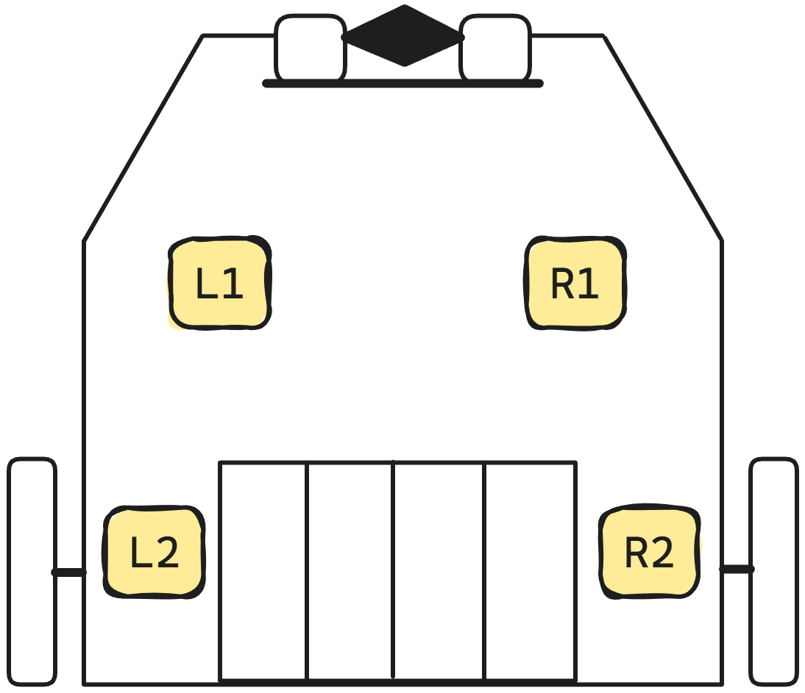

import LED from '@tdev/pyodide/led_control/src/components/LED';
import HslColorPicker from '../components/HslColorPicker';
import Steps from '@tdev-components/Steps';

# LED's

Der Maqueen hat mehrere LED's, die einzeln angesteuert werden können.

:::def[Farb-LED's]

Der Maqueen hat an der Unterseite 4 Farb-LED's.



```py
from maqueen import *

# alle Farb-LED's in rot einschalten
led_rgb(Color.RED)

# die LED vorne links auf grün setzen
led_rgb(Color.GREEN, ColorLED.L1)

# eigene RGB-Farbe vorn rechts setzen
led_rgb(rgb(255, 128, 0), ColorLED.R1)

# Blau für alle LED's bei einer Helligkeitsstufe 50 setzen.
led_rgb(Color.BLUE, brightness=50) # Ändert die globale Helligkeit nicht.

# HSL-Farben
led_rgb(hsl(  0, 100, 50)) # => LED's in rot
led_rgb(hsl(180, 100, 50)) # => LED's in cyan
```

Referenz
: [👉 Dokumentation/led-rgb](https://gbsl-informatik.github.io/maqueen-plus-v2-mpy/docs/api/led-rgb#api)
:::


Farbcodierungen mit RGB (Rot, Grün, Blau) sind sehr gebräuchlich. Dabei wird jede Farbe durch die Anteile der drei Grundfarben beschrieben.

## HSL-Farben

Farben können aber auch in **HSL** (***H**ue* für den Farbton, ***S**aturation* für die Sättigung, und ***L**ightness* für die Helligkeit) angegeben werden. Der **Vorteil** davon ist, dass die eigentliche Farbe auf einem Farbkreis definiert wird. Dies ermöglicht es etwa, die Farbe abhängig vom Winkel zu setzen. So ist es einfach möglich, Farben zu wählen, die harmonisch zusammenpassen und etwa Farbverläufe zu erzeugen.

<HslColorPicker />

---

:::aufgabe[HSL-Farben]
<Answer type="state" id="569857de-c411-4e92-8c5e-7112c89c54bc" />

Verwenden Sie die Schiebregler im Farbwähler, um die HSL-Werte zu verändern. Halten Sie fest, was die einzelnen Parameter (Hue, Saturation, Lightness) bewirken.
- Mit welchem Regler ändere ich die Farbe (z.B. von rot zu grün zu blau)?
- Mit welchem Regler erzeuge ich Pastelltöne?
- Mit welchem Regler erzeuge ich dunkle Farben?

<Answer type="text" id="5cf23f5a-cf81-43a8-931c-013ea2556de0" />
:::

Die HSL-Farben können wir später verwenden, um die Farb-LED's des Maqueen zu steuern. Vorerst betrachten wir die Farben aber isoliert.

## Teilbarkeit von Zahlen
*Wiederholung - siehe Programmieren 1*

Ist eine Zahl ganzzahlig durch eine andere Zahl teilbar? Diese Frage lässt sich mit dem **Modulo-Operator** leicht beantworten.

:::def[`%` - Modulo-Operator]
Der **Modulo-Operator** `%` gibt den **Rest** einer ganzzahligen Division zurück.

```py live_py slim
# 7 modulo 3 ergibt 1, da 7 / 3 = 2 Rest 1
print(7 % 3)
```
:::

Der Modulo-Operator `%` gibt also den ganzzahligen Rest einer Division zurück. **Dies ist immer dann nützlich, wenn eine Zahl in einem bestimmten Bereich gehalten werden soll.**

Sollen also nacheinander die Zahlen `0`, `1`, `2` ausgegeben werden, so kann dies mit dem Modulo-Operator erreicht werden:

```py live_py slim
for i in range(20):
    print(i % 3)
```

Dies kann auch verwendet werden, um die Farbe `Hue` in einem Farbkreis zu immer zwischen 0 und 360 halten und so eine durchgehende Farb-Animation zu erzeugen.

Mit der Bibliothek `led_control` **simulieren** wir die Steuerung einer LED-Komponente in unserem Code.

<LED ledId='hsl-led' />

```py live_pyo slim
from time import sleep
from led_control import use_led
led = use_led('hsl-led')

led.set_hsl(0, 100, 50)
sleep(1)
led.set_hsl(120, 100, 50)
sleep(1)
led.set_hsl(240, 100, 50)
sleep(1)
led.reset()
```

:::warning[`use_led`]
Damit die richtige LED-Komponente angesprochen wird, muss die ID (hier `'hsl-led'`) mit der ID übereinstimmen, die in der LED-Komponente angezeigt wird.
:::

:::aufgabe[Code untersuchen]
<Answer type="state" id="2a2a2fd8-6770-4110-939b-4f7534435903" />

Untersuchen Sie den obigen Code 
- welche Farben werden für wie lange angezeigt?
- was bewirkt der Befehl `led.reset()`?
- welechn Unterschied gibt es zwischen dem `sleep()` Befehl in der Simulation und dem `sleep()` Befehl auf dem Micro:bit?

<Answer type="text" id="70df01c2-13d6-4e1c-bbf8-67d4e42238e7" />
:::

::::aufgabe[Übergänge]
<Answer type="state" id="20283bda-45ac-49a5-95f2-fa48dd4d6582" />
Erzeugen Sie eine durchgehende Farbanimation (mit einer `while`-Schleife), bei der sich die Farbe der LED kontinuierlich ändert. Verwenden Sie dazu den Modulo-Operator, um den Hue-Wert auf den Werteberich von 0-360 zu begrenzen.

::video[./images/animate.mp4]{width="100%" height="200px" autoplay=true}

<LED ledId='übergänge' />

<Steps>
  1. ```py live_pyo id=df0e21f4-696f-4f0f-81ca-9b3d0af270a5
     from time import sleep
     from led_control import use_led
     led = use_led('übergänge')

     ```
  2. Versuchen Sie nun, den Code auf den Maqueen zu übertragen - die `sleep()` Funktion könnte ein Stolperstein sein und der Farbwechsel muss leicht angepasst werden.
     ```mpy live_py id=e0153d58-649d-452c-85b5-f4cfa1cec630
     from microbit import *
     from maqueen import *

     ```
</Steps>
::::

:::warning[Lightness]
Die Lightness (letzter Parameter) gibt an, wie hell die Farbe ist. `0` ist schwarz, `100` ist weiss. Sollen satte Farben angezeigt werden, sollte die Lightness auf ca. `50` gesetzt werden.
:::

::::aufgabe[Farb-Disco]
<Answer type="state" id="5ad417e2-37f2-454b-9a3d-8727aa30983a" />

Studieren Sie den folgenden Code und passen Sie ihn so an, dass die Farben nach einer Umdrehung wieder auf rot gesetzt werden. Der Roboter soll sich unendlich lang drehen und dabei die Farben wechseln.

```mpy live_py id=48d2c03f-b4f2-4b98-ac20-20d1afeef380
from microbit import *
from maqueen import *

motor_run(Motor.LEFT, 20)
motor_run(Motor.RIGHT, -20)

angle = 0
while True:
    led_rgb(hsl(angle, 100, 50))
    angle = angle + 1
    sleep(10) # für 10 ms warten
```

#### Hilfestellungen

:::details[Hinweis 1]{.orange}
Verwenden Sie den Modulo-Operator `%` um den Winkel auf 360 zu begrenzen.
:::
:::details[Hinweis 2]{.orange}
Stoppen Sie die Zeit, die für eine Umdrehung benötigt wird. Berechnen Sie damit, wie lange gewartet (`sleep`) werden muss, bis die Farbe nächste Farbe gesetzt wird.
:::
:::details[Hinweis 3]{.orange}
Berechnung der Wartezeit:
$$
\text{{Wartezeit}} = \frac{\text{Zeit für 360° in Sekunden} \cdot 1000}{360}
$$
:::
::::
