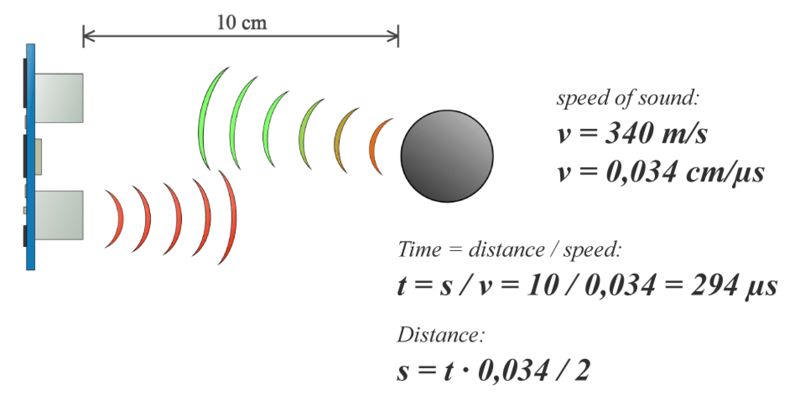

# Ultraschall-Sensor

Mit dem Ultraschall-Sensor kann die Entfernung zu einem Objekt gemessen werden. Dabei werden Ultraschallwellen ausgesendet und die Zeit gemessen, bis das Echo zurückkommt.



Zum Glück müssen Sie sich nicht um die genaue Berechnung kümmern, sondern können die Funktion `ultrasonic()` verwenden, was die Entfernung in `cm` zurückgibt.

:::aufgabe[Ultraschall-Sensor und Mikrofon]
<Answer type="state" id="51858d69-2fe6-4a81-bbbe-2a0f7fd5d576" />

1. Studieren Sie die rudimentäre Hinderniserkennung im Code-Beispiel auf der Webseite: [👉 Hinderniserkennung](https://gbsl-informatik.github.io/maqueen-plus-v2-mpy/docs/examples/obstacle-avoidance)
2. Probieren Sie den Code aus und halten Sie fest, wie der Algorithmus funktioniert. Insbesondere, wie der Drehwinkel des Maqueen eingestellt wird.
    <Answer type="text" id="0bc69733-d362-42b3-b9f1-7c9b35c84218" />
3. Ändern Sie das Programm so ab, dass der Maqueen auch die Richtung wechselt, wenn in die Hände geklatscht wird.

```mpy live_py id=76d88313-309d-40a2-a79d-1f33b97202ff

```
:::

:::aufgabe[Ultraschall Lead-and-Follow]
<Answer type="state" id="25293200-bca2-4590-82a2-39f66d12f85f" />

Schreiben Sie ein Programm, bei welchem der Maqueen immer `10 cm` Abstand zu Ihrer Hand hält. Ist die Distanz kleiner, fährt der Maqueen rückwärts, ist die Distanz grösser, fährt er vorwärts. Eine Richtungsänderung erfolgt dabei nie.

::video[./images/lead-and-follow.mp4]{autoplay loop}


```mpy live_py id=a68792f6-f832-4d74-9d9e-80ee1d2762e6

```
:::
