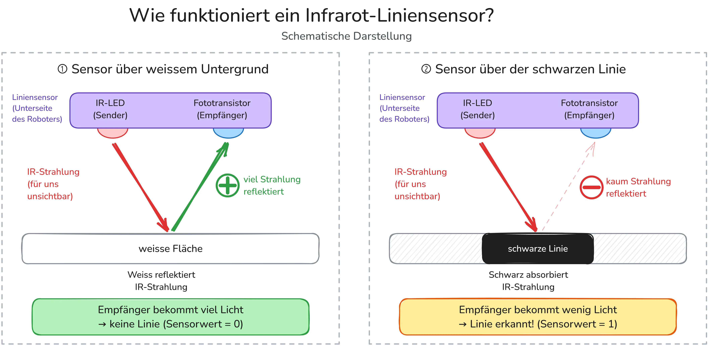
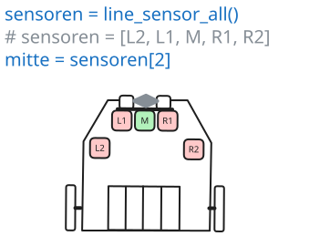
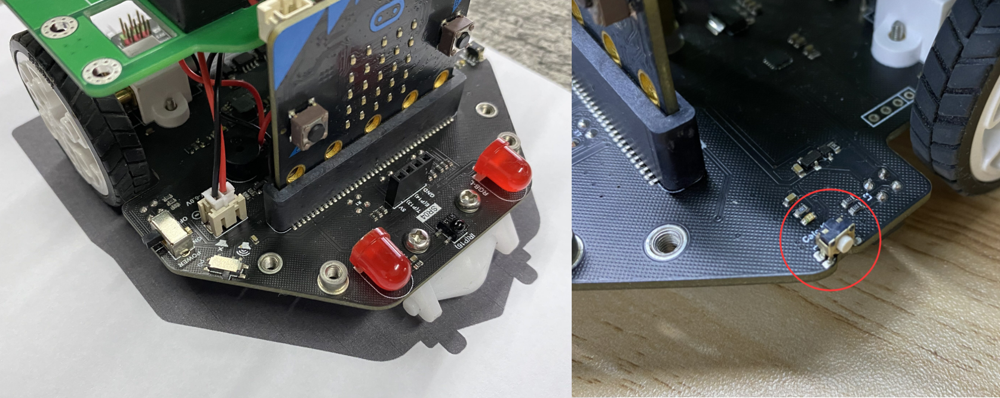

import ProgressState from '@tdev-components/documents/ProgressState';
import Restricted from '@tdev-components/documents/Restricted';
import { DynamicInput, TemplateCode, Val } from '@tdev-components/DynamicValues';
import Steps from '@tdev-components/Steps';

# Liniensensoren

Der Maqueen hat fünf Liniensensoren, welche schwarze Linien erkennen können. Dazu wird Infrarotstrahlung ausgesendet und die Reflexion gemessen. Je nach Reflexion wird ein Sensorwert von `0` oder `1` zurückgegeben.

:::insight[Infrarot-Sensoren]


Schwarz
: Sensorwert __1__
Weiss
: Sensorwert __0__
:::


Die Sensoren sind wie folgt angeordnet und können mit `line_sensor_all()` ausgelesen werden:




:::aufgabe[Experiment]

Micro\:Bit Editor
: [https://python.microbit.org/v/3](https://python.microbit.org/v/3)
Maqueen Bibliothek
: [https://gbsl-informatik.github.io/maqueen-plus-v2-mpy/](https://gbsl-informatik.github.io/maqueen-plus-v2-mpy/)

Laden Sie folgendes Programm auf den Maqueen.
```py
from microbit import *
from maqueen import *

while True:
    data = line_sensor_all()
    raw = line_sensor_data_all()
    print("Sensoren: ", data, " Rohwerte: ", raw)
```

Betrachten Sie das Display und die Ausgabe im Serial-Monitor:
- was passiert, wenn alle Sensoren auf schwarzem/weissem Untergrund sind?
- was passiert, wenn nur einzelne Sensoren auf schwarzem Untergrund sind?

**Beobachten und dokumentieren Sie für jeden Schritt obige Fragen.**

<ProgressState id="a1ddd922-c426-43a2-999e-705dca9cb376" confirm keepPreviousStepsOpen >
1. Maqueen ist noch mit dem USB-Kabel mit dem Laptop verbunden: was passiert?  
    <Answer type="text" id="688533ee-c6d6-459b-b30e-4f57e7ee134b" />
2. Stellen Sie den Maqueen auf die schwarze "Maqueen Plus" Kontur und halten Sie __Calibrate__ für 5 Sekunden gedrückt, bis die roten LEDs vorn blinken.  
    
    
    
    Beobachten Sie nun die Ausgaben erneut. Wiederholen Sie die Kalibrierung ein paar Mal - verändert sich die Ausgabe?
    
    <Answer type="text" id="9b0f029c-d50c-42cc-8bad-6a2e98a88d10" />
3. Was passiert, wenn eine Milchfolie über die schwarze Linie gelegt wird? Hilft die Kalibrierung? Was wenn beide Situationen (schwarze Linie mit- und ohne Milchfolie) korrekt erkannt werden sollen?
    <Answer type="text" id="0b01548e-d55b-40e1-9f70-a0fd97cc72c2" />
</ProgressState>
:::

Um die Kalibrierung der Sensoren zu verbessern, können die Sensorwerte individuell angepasst werden. Dazu wird eine Software-Kalibrierung durchgeführt.

export const asList = (val) => {
    if (!val || typeof val !== 'string') {
        return "[80, 80, 80, 80, 80]"
    }
    return `[${val.replace(/[\[\]]/g, '')}]`
}

:::insight[Robustere Kalibrierung]
Der __Calibrate__-Knopf kalibriert alle 5 Sensoren genau gleich. Offensichtlich messen diese aber jeweils unterschiedlich (Hardware-Abweichungen, günstige Bauteile). Durch eine Software-Kalibrierung können die Sensoren individuell angepasst werden.

<Steps>
1. Maqueen auf das Kalibrations-Feld stellen - mit dem Kabel verbunden.
2. Die Hardware-Kalibrierung über die __Calibrate__-Taste durchführen.
3. Folgenden Code auf dem Maqueen ausführen:
    ```py
    from microbit import *
    from maqueen import *

    recalibrate()
    ```
4. Code ausführen und mit der Taste __A__ die Software-Kalibrierung starten.
5. Die Kalibrierungswerte der Ausgabe im Serial-Monitor festhalten:
    <DynamicInput name="LineCalibration" placeholder="[80, 80, 80, 80, 80]" monospace/>
    <DynamicInput name="LineCalibrationList" default={(store) => asList(store.dynamicValues.get('LineCalibration'))} monospace hidden />
6. Alle Programme, die auf dieser Unterlage laufen, starten nun mit der Software-Kalibrierung:
    <TemplateCode>
    ```py
    from microbit import *
    from maqueen import *

    # Software-Kalibrierung der 5 Liniensensoren
    calibrate({{LineCalibrationList}})
    ```
    </TemplateCode>
</Steps>
:::

:::aufgabe[Software-Kalibrierung ausprobieren]
<Answer type="state" id="7a0b0f87-e43f-4a75-8c2e-beae56b50751" />

Probieren Sie die obige Software-Kalibrierung aus, indem Sie die obigen Schritte durchführen und danach den vorherigen Code anpassen und erneut ausführen. Beobachten Sie die Ausgabe im Serial-Monitor und vergleichen Sie die Werte mit den vorherigen Werten. Hat sich die Kalibrierung verbessert?

<Answer type="text" id="39797b70-9fe4-4d9f-b9a4-b81510e86567" />
:::

:::aufgabe[Linienfolger]
<Answer type="state" id="f860c10b-9c52-4720-b3b8-33c1bcc6bca5" />

Können Sie einen simplen Linienfolger programmieren, der den kreisrunden Parcours schafft? Vergessen Sie nicht, die Kalibrierung zu verwenden - dann kann nämlich auch eine Milchfolie das Kurvenfahren nicht verhindern :)

```mpy live_py id=1f26225c-eff1-443d-b599-d58a8b3a8e85

```
:::