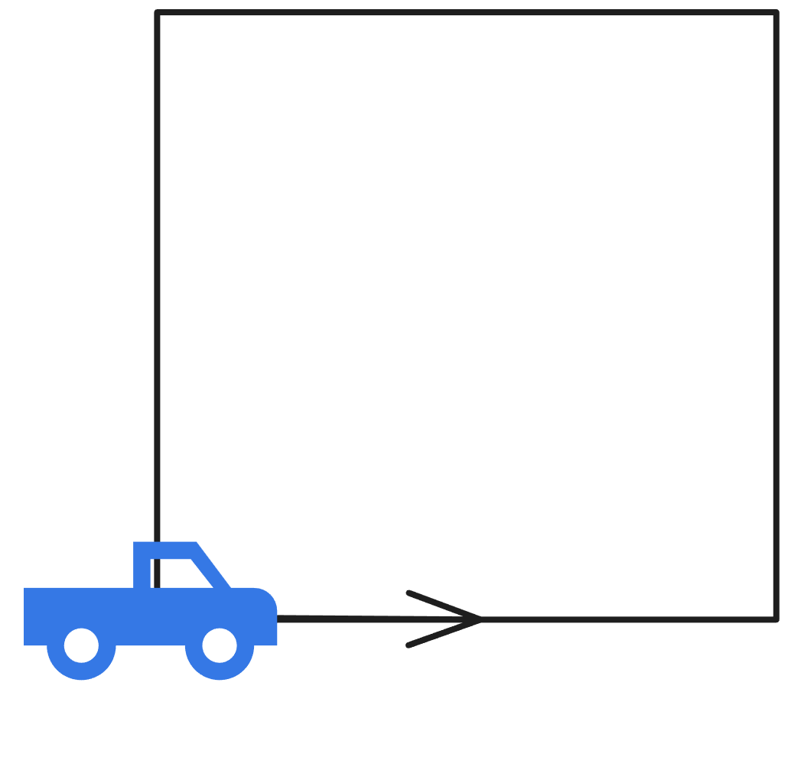
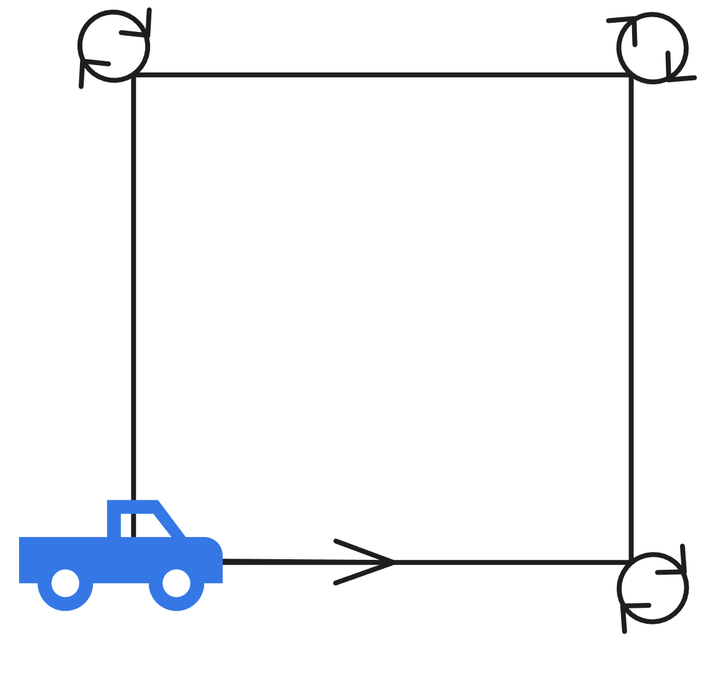

# 3. Robotik Intro

:::aufgabe[Inbetriebnahme Maqueen]
<Answer type="state" id="0eff77c4-2629-4b69-bb87-2d0b1279e6f3" />

Dokumentation
: [👉 Installation](https://gbsl-informatik.github.io/maqueen-plus-v2-mpy/docs/)

Nehmen Sie den Maqueen gemäss folgender Anleitung in Betrieb. Für jedes Maqueen-Programm müssen diese Schritte zu Beginn durchgeführt werden. 

::video[./images/maqueen-intro.mp4]{autoplay loop}

1. Überprüfen Sie, dass der Maqueen nach rechts dreht, dann gerade aus fährt und anhält. 
2. Markieren Sie die Aufgabe als erledigt.
:::

---

:::def[Motoren `motor_run(motor, speed)`]
Lässt den gewählten Motor mit der angegebenen Geschwindigkeit laufen.

Die Geschwindigkeit kann zwischen `-255` und `255` liegen. Negative Werte bedeuten, dass der Motor rückwärts läuft.

Welcher Motor angesteuert wird, muss mit einer Zahl (oder der Konstantent aus `Motor`) angegeben werden:

Links
: `0` oder `Motor.LEFT`
Rechts
: `1` oder `Motor.RIGHT`
Beide
: `2` oder `Motor.ALL`

```py
# den linke Motor mit 100% Geschwindigkeit vorwärts drehen lassen
motor_run(0, 255)
# oder äquivalent
motor_run(Motor.LEFT, 255)

# den rechten Motor rückwärts mit 50% drehen lassen
motor_run(Motor.RIGHT, -128)

# beide Motoren vorwärts drehen mit 100%
motor_run(Motor.ALL, 255)
```

Referenz
: [👉 Dokumentation/motor#motor_runmotor-speed](https://gbsl-informatik.github.io/maqueen-plus-v2-mpy/docs/api/motor#motor_runmotor-speed)

:::

::::aufgabe[Spinner]
<Answer type="state" id="ec3cd836-1388-45f8-b724-003d67bbad21" />

Schreiben Sie ein Programm, welches den Maqueen an Ort und Stelle drehen lässt. Verwenden Sie dazu die oben beschriebene Funktion `motor_run()`.
Halten Sie den Code unten fest.

:::details[Hinweis]
Um den Maqueen an Ort und Stelle drehen zu lassen, müssen die Motoren in **entgegengesetzte Richtungen** laufen. Der linke Motor muss also vorwärts und der rechte Motor rückwärts laufen.
:::

```mpy live_py id=3f0e7c8b-1d5a-4f6e-9c2b-1f3e5d6a7b8c

```
::::

---

::::def[`sleep(ms)`]
Mit der Funktion `sleep(ms)` kann die Codeausführung für die angegebene Anzahl Millisekunden **pausiert** werden.

Während der Micro:bit wartet/schläft, kann er keine anderen Befehle ausführen.
:::warning[Motoren drehen sich weiter]
Bereits drehende Motoren drehen sich während dem `sleep()` weiter, wie auch die LED's bleiben im gleichen Zustand - nur neue Befehle werden nicht ausgeführt.
:::

```py
from microbit import *
from maqueen import *

while True:
    motor_run(Motor.ALL, 255)
    sleep(1000) # wartet 1 Sekunde
    motor_run(Motor.ALL, -255)
    sleep(1000) # wartet 1 Sekunde
```
::::

:::def[Motor stoppen `motor_stop()`]

Mit `motor_stop()` werden alle Motoren gestoppt. Optional kann auch nur ein Motor gestoppt werden.

```py
# stoppt beide Motoren
motor_stop()
# stoppt den linken Motor
motor_stop(0)
# oder äquivalent
motor_stop(Motor.LEFT)
```

Referenz
: [👉 Dokumentation/motor#motor_stop](https://gbsl-informatik.github.io/maqueen-plus-v2-mpy/docs/api/motor#motor_stop)
:::

:::aufgabe[Start & Stop]
<Answer type="state" id="6cf81cb3-7ac0-4ca9-b63e-45e35453c8ef" />

Setzen Sie das folgende Programm um: Der Maqueen fährt los, sobald in die Hände geklatscht wird. Ein weiterer Klatsch stoppt den Maqueen wieder.

Ausgangslage
: Der Maqueen steht still.
Klatschen
: **steht** der Maqueen still, so beginnt er zu fahren.
: **fährt** der Maqueen bereits, so stoppt er.
Referenz
: [Micro:Bit Mikrofon](https://python.microbit.org/v/3/reference/microphone)


```mpy live_py id=176dc00f-8697-44ad-b514-501f027b48dd

```

:::


:::warning[Geradeausfahern]
Die Drehgeschwindigkeit der Motoren wird über die Spannung gesteuert, was leider nicht sehr präzise ist. Daher kann es sein, dass der Maqueen nicht geradeaus fährt, sondern eine Kurve macht - auch wenn bei beiden Motoren derselbe Zahlenwert eingestellt ist. Dies muss durch Ausprobieren und Anpassen der Geschwindigkeit der Motoren korrigiert werden.
:::

:::tip[Hinweis Kurvenfahren]
Kurvenfahren kann durch unterschiedliche Geschwindigkeiten der linken- und rechten Motoren erreicht werden. Soll der Maqueen an Ort und Stelle drehen, so müssen die Motoren in entgegengesetzte Richtungen laufen.
:::

:::aufgabe[Quadrat fahren]
<Answer type="state" id="cac5a052-f977-4649-a918-214ecfe85c92" />

Schreiben Sie ein Programm, das den Maqueen ein Quadrat fahren lässt. Halten Sie den Code unten fest.



```mpy live_py id=320176d9-f2b5-4345-a576-2c04e333c192

```

<Solution id="48efdf30-68b3-4dee-8286-6c1aafe1309d">

#### Ansatz 1: Wiederholungen brauchen

```py
from microbit import *
from maqueen import *

for i in range(4):
    motor_run(Motor.ALL, 255)
    sleep(1000)

    motor_run(Motor.RIGHT, 100)
    motor_run(Motor.LEFT, -100)
    sleep(1900)
motor_stop()
```

#### Ansatz 2: Funktionen schreiben, die man einfach anpassen kann

```py
from microbit import *
from maqueen import *

TIME_FOR_360 = 1900 # Zeit in ms um sich um 360° zu drehen (bei 100 Geschwindigkeit)
TIME_FOR_1M = 4000  # Zeit in ms um 1m zu fahren (bei 255 Geschwindigkeit)

def forward(distanz):
    motor_run(Motor.ALL, 255)
    sleep(distanz * TIME_FOR_1M)
    motor_stop()

def left(winkel):
    motor_run(Motor.RIGHT, 100)
    motor_run(Motor.LEFT, -100)
    sleep(winkel * TIME_FOR_360 / 360)
    motor_stop()

## Programm fürs Quadrat
for i in range(4):
    forward(0.25)
    left(90)
```

</Solution>

### ⭐ Zusatz
Ändern Sie das Programm so ab, dass der Maqueen an den Ecken jeweils eine zusätzliche 360 ° Drehung vollzieht.


```mpy live_py id=6187de79-61f4-4262-9a0e-034ff028904b

```

:::

